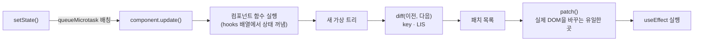

# Mini-React

> 크래프톤 정글 13기 · Virtual DOM, Diff, Hooks를 **라이브러리 없이** 직접 구현한 미니 React


**특화 방향: "하지 않아도 될 일을 하지 않는 미니 React — 그리고 그것이 맞다는 증명"**
대량 목록에서 DOM 변경을 이론 최소로 줄이고(성능), 줄여도 결과가 브라우저와 같다는 것을 테스트로 증명하며(정확성),
그 과정을 데모 화면에서 숫자로 보여 준다(학습).

---

## 목차
1. [한눈에 보기](#한눈에-보기)
2. [구조](#구조)
3. [데모 실행](#데모-실행)
4. [고도화 진행 상황](#고도화-진행-상황)
5. [벤치마크 하이라이트](#벤치마크-하이라이트)
6. [개발 환경](#개발-환경)
7. [문서](#문서)

## 한눈에 보기

| | 구현한 것 |
|---|---|
| **Phase 1** Virtual DOM · Diff · Patch | 실제 DOM ↔ 가상 노드 변환, 패치 6종(CREATE·REMOVE·REPLACE·PROPS·TEXT·MOVE), key 목록의 **LIS 기반 최소 이동**, patch 실패 시 이전 화면 복구 |
| **Phase 2** Component · Hooks | `FunctionComponent`(hooks 배열 · `mount()` · `update()`), `useState`·`useEffect`·`useMemo`, 마이크로태스크 배칭, 무한 갱신 방지, effect 정리 순서 보장 |
| **연결** | `setState` → 새 가상 트리 → Phase 1의 `diff` → `patch` 하나의 파이프라인 |
| **검증** | 단위·기능 테스트 272개, 기준 렌더러와 대조하는 시드 고정 fuzz, CI 성능 예산 |

## 구조



```
src/
├─ vdom/   createElement · vnode · domToVNode(실제 DOM → 가상 노드) · serialize · render
├─ diff/   diff(비교) · lis(최장 증가 부분 수열) · patch(실제 DOM 반영)
└─ hooks/  component(FunctionComponent) · hooks(useState·useEffect·useMemo)
demo/      phase1 · phase2 · integrated(종합) · shared
scripts/   serve.js(정적 서버) · bench/(벤치마크)
docs/      요구사항 체크리스트 · 제안서 · ADR · 벤치마크
```

## 데모 실행

```bash
npm ci
npm run serve   # → http://127.0.0.1:5173/demo/
```

| 페이지 | 무엇을 볼 수 있나 |
|---|---|
| **Phase 1** `demo/phase1/` | 실제 영역과 테스트 영역. 테스트 영역 HTML을 고치고 **Patch**를 누르면 바뀐 곳만 실제 영역에 반영되고, **뒤로가기·앞으로가기**로 State History를 오간다 |
| **Phase 2** `demo/phase2/` | 훅으로 만든 학습 트래커. 렌더마다 패치 목록과 `hooks` 배열을 옆 패널에 보여 준다 |
| **종합** `demo/integrated/` | 모니터(렌더 파이프라인) + 키보드(백로그 앱) 배치. 앱을 조작하면 ① setState → ② 새 가상 트리 → ③ diff 패치 → ④ 실제 DOM 변경(MutationObserver)을 단계별로 보여 주고, 동작마다 개념 카드(LIS·key·배칭 등)와 React 방식과의 이동 횟수 비교가 뜬다. 뒤로가기·앞으로가기·초기화 지원 |

`npm run serve`는 이 컴퓨터(127.0.0.1)에서만 열리고 `demo/`·`src/`만 내보낸다.

## 고도화 진행 상황

과제 필수 요구사항을 모두 채운 뒤([체크리스트](docs/requirements-checklist.md)), 세 역할이 각자 제안서를 내고 **측정값으로 서로의 안을 검증**해 계획을 정했다 → [ADR 0001](docs/decisions/0001-plan.md).

| 역할 | 맡은 것 |
|---|---|
| 총괄 | 요구사항 추적, 병합 게이트(검사·성능 예산·도메인 규칙) 확인 |
| 성능 | 대량 목록 diff·patch 최적화, 벤치마크, 성능 예산 |
| 정확성·학습 | 엣지 케이스 버그, 브라우저 대조 fuzz, 데모의 개념 설명 |

### 로드맵

| 단계 | 작업 | 상태 |
|:---:|---|:---:|
| 0 | 요구사항 체크리스트 · 제안서 3개 · ADR 0001 | ✅ |
| 1 | **B1** 다중 `select` 선택 오류(fuzz 6,000번 중 377번) · **B2** input `type` 변경 시 `value` 잔존 수정 | ✅ |
| 1 | 벤치마크 하네스 `npm run bench` · CI 성능 예산 테스트 · React 방식과 이동 횟수 비교 | ✅ |
| 2 | **B3** 주석으로 갈린 텍스트 때문에 "아무것도 안 고친 Patch"가 DOM을 바꾸던 문제 수정 | ✅ |
| 2 | 개념 설명 추가 (Document·Window, DOM 변화 감지, 컴포넌트 나누기, State 위치) | 🔄 |
| 3 | 브라우저 파서를 정답으로 삼는 차등 fuzz (불일치 0, CI +3초 이내) | ⏳ |
| 4 | **핸들러 상자**: 렌더마다 새 핸들러여도 패치를 만들지 않음 (같은 데이터 다시 렌더 패치 2,000 → 0) | 🔄 |
| 5 | 연속 생성·전체 삭제를 한 번에 (DOM 연산 1,000 → 1) | ⏳ |
| 6 | 자식 비교 빠른 경로 (같은 데이터 diff 19ms → 10ms 이하) | ⏳ |
| 7 | Phase 1 프리셋(table·form·SVG 등) · 브라우저 벤치마크 페이지 | ⏳ |
| 8~10 | 실제 React와의 차이 문서 · 조건부 최적화(memo 등) · 포트폴리오 정리 | ⏳ |

✅ 완료 · 🔄 진행 중 · ⏳ 예정

### 병합 기준
- `bash .claude/check.sh` 통과 (모든 테스트)
- **강한 성능 예산**(CI 실패 조건): 패치 수 · DOM 변경 기록 수 · 붙이고 뗀 노드 수 · 새 노드 수 — 매번 같은 값이 나오는 지표만 쓴다
- 약한 예산(기록만): diff·patch ms. jsdom 시간은 실행마다 ±30% 흔들려 실패 조건으로 쓰지 않는다
- 도메인 규칙: 실제 DOM 변경은 patch에서만, 훅은 루트 컴포넌트에서만, 자식은 순수 함수, 런타임 의존성 0

## 벤치마크 하이라이트

1,000행 표 기준(Node 22 + jsdom 26, 11회 중앙값). 전체 표와 측정 방법은 [docs/benchmarks.md](docs/benchmarks.md).

| 시나리오 | 우리 엔진(MOVE) | LIS 이론 최소 | React 방식(`lastPlacedIndex`) |
|---|---:|---:|---:|
| 두 행 swap (1 ↔ 998) | **2** | 2 | 997 |
| 맨 뒤 → 맨 앞 | **1** | 1 | 999 |
| 뒤집기 | 999 | 999 | 999 |

- **이동은 이미 최소다.** React는 앞에서부터 "제자리에 둔 마지막 위치"보다 앞에 있던 노드를 모두 옮기고, 이 엔진(과 Vue 3)은 LIS로 그대로 둘 노드를 고른다.
- **다음 목표:** 렌더마다 새로 만들어지는 핸들러 때문에 DOM은 그대로인데 패치가 2,000개 생긴다 → 핸들러 상자(4단계)로 0을 노린다.

```bash
npm run bench                                       # 1k, 11회 중앙값
npm run bench -- --rows 10000 --runs 1 --warmup 0   # 10k
npm run bench -- --only swap                        # 시나리오 하나
```

## 개발 환경
- Node `^20.19.0 || >=22.12.0` (CI는 Node 20)
- 설치: `npm ci` / 테스트: `npm test` / 전체 검사: `bash .claude/check.sh`
- 의존성을 추가하거나 바꿀 때(lock 파일이 바뀌는 설치)는 `npx npm@11 install <패키지>`로 한다.
  npm 10.9.x의 `npm install`은 vitest@4의 선택적 peer 의존성을 계산하다가 `Cannot read properties of null (reading 'edgesOut')`로 실패한다.
  `npm ci`는 npm 10에서도 정상 동작한다.

## 문서
- [요구사항 체크리스트](docs/requirements-checklist.md) — 과제 조건별 충족 여부와 증거(파일:줄, 테스트 이름)
- [ADR 0001 고도화 계획](docs/decisions/0001-plan.md) — 특화 분야, 개선 목록, 성능 예산, 버린 안과 이유
- [벤치마크](docs/benchmarks.md) — 지표 정의, 기준선 표, 읽은 것
- [총괄 제안서](docs/proposals/mr-lead.md)
