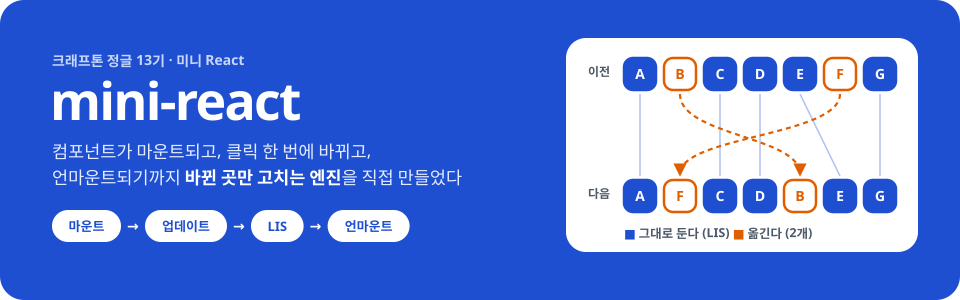
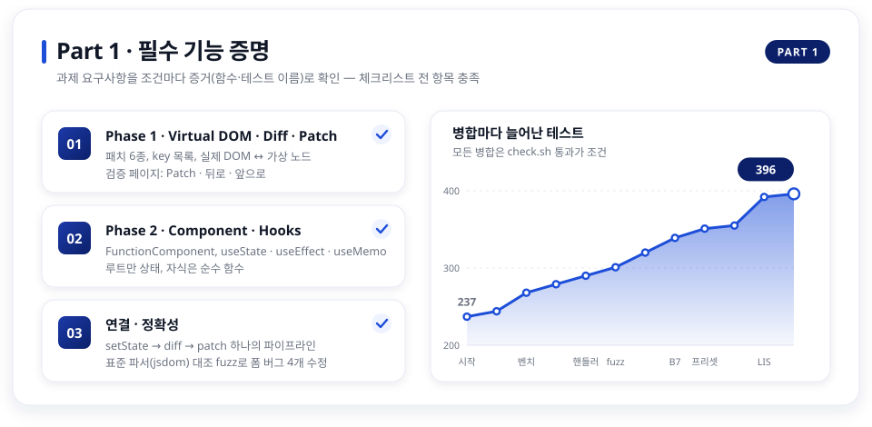
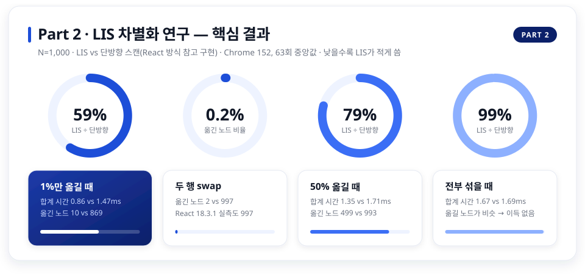
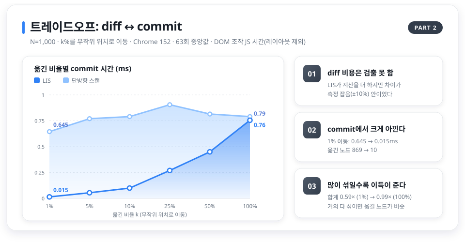
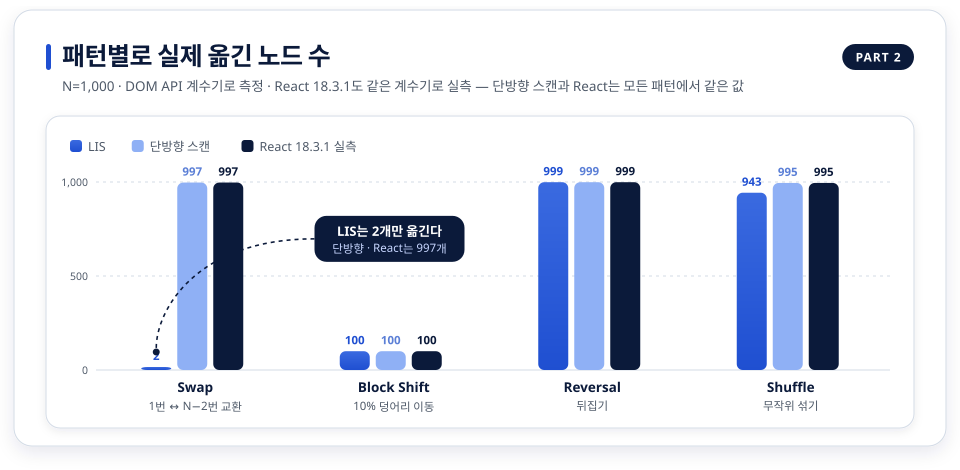
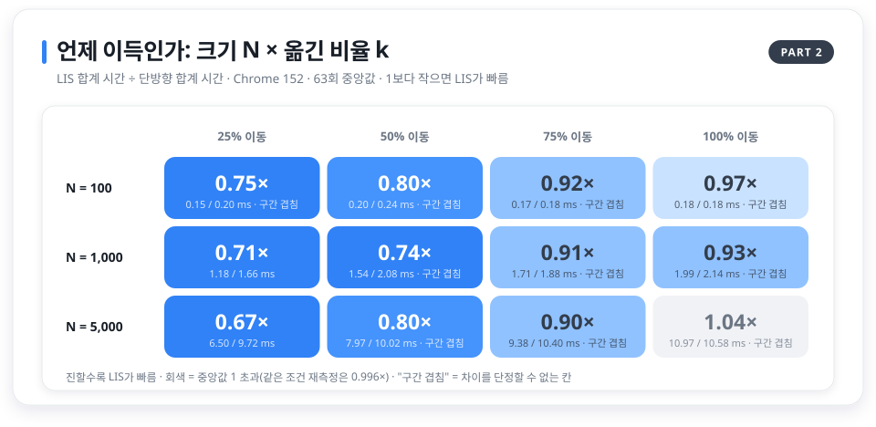
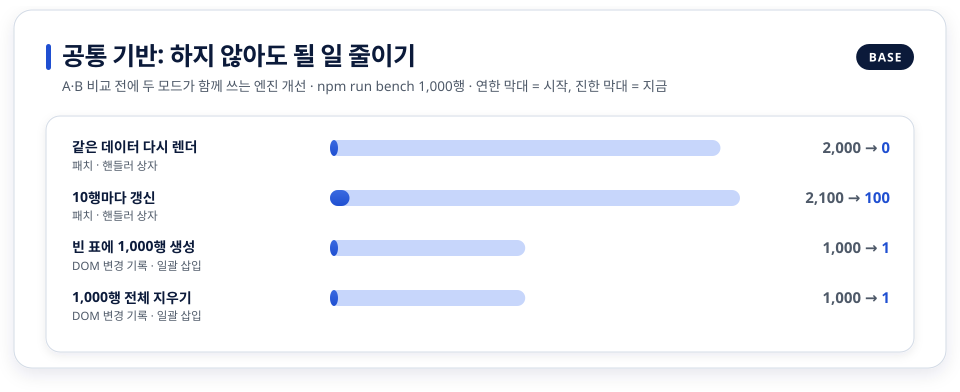

<div align="center">



<br>

**"React의 핵심을 직접 만들고, 그 위에서 하나의 알고리즘을 끝까지 재 봤다"**

<p>
  
  
  
  
</p>

<sub>크래프톤 정글 13기 · 미니 React 구현 과제</sub><br>
<sub>구현(`src/`)과 과제 데모 3종은 Vanilla JS이며 React를 쓰지 않습니다. `react`·`react-dom` 18.3.1은 Part 2 실험의 <b>비교 기준선</b>으로만 devDependency에 있고, 테스트가 이를 검사합니다.</sub>

[전략](#-두-단계-전략) · [Part 1 필수 기능](#-part-1--필수-기능-증명) · [Part 2 LIS 연구](#-part-2--lis-차별화-연구) · [트레이드오프](#-트레이드오프-어디서-무엇을-내주고-얻나) · [실행](#-실행-방법) · [문서](#-문서)

</div>

<br>

## 🧭 두 단계 전략

| | 무엇을 | 어떻게 증명했나 |
|:---:|---|---|
| **Part 1** | 과제 필수 기능: Virtual DOM · Diff · Patch, Component · Hooks, 두 Phase 연결 | 요구사항을 조건마다 증거(함수·테스트 이름)로 확인, HTML 표준 파서 구현(jsdom)과 대조하는 fuzz |
| **Part 2** | 차별화 연구: **LIS 기반 keyed 재조정은 언제 이득이고 언제 아닌가** | 이동 판단만 다른 두 모드(LIS / 단방향 스캔)와 실제 React 18.3.1을 같은 조건·같은 계수기로 측정 |

> "React보다 빠르다" 같은 말은 하지 않습니다. 이득이 나는 조건과 **이득이 없거나 손해인 조건을 함께** 보고합니다.

<br>

## ✅ Part 1 · 필수 기능 증명



| 영역 | 구현한 것 |
|---|---|
| **Phase 1** Virtual DOM · Diff · Patch | 실제 DOM ↔ 가상 노드 변환, 패치 6종(CREATE · REMOVE · REPLACE · PROPS · TEXT · MOVE), key 목록 비교, patch 실패 시 이전 화면 복구. 검증 페이지에 Patch · 뒤로가기 · 앞으로가기 |
| **Phase 2** Component · Hooks | `FunctionComponent`(hooks 배열 · `mount()` · `update()`), `useState` · `useEffect` · `useMemo`, 마이크로태스크 배칭, 무한 갱신 방지. 상태는 루트만, 자식은 props만 받는 순수 함수 |
| **연결** | `setState` → 새 가상 트리 → Phase 1의 `diff` → `patch` 하나의 파이프라인 |

**정확성** — 정답지를 HTML 표준 파서 구현(jsdom의 `innerHTML`)으로 두고, 무작위 HTML을 엔진으로 patch한 결과와 비교했습니다. 실제 Chrome에서 같은 fuzz를 돌리지는 않았습니다.

| 버그 | 증상 | 찾은 방법 |
|---|---|---|
| **B1** | 다중 select에서 일부 선택이 사라짐 | fuzz 6,000번 중 377번 |
| **B2** | input `type`을 바꿔도 이전 `value`가 속성으로 남음 | 폼 엣지 케이스 조사 |
| **B6** | 빈 select에 option을 넣으면 마지막 것이 선택됨 | fuzz 긴 실행 |
| **B7** | 단일 선택 select · 같은 name radio의 형제 선택이 풀린 채 남음 | fuzz 긴 실행 |

<details>
<summary><b>데모 페이지 4종</b></summary>
<br>

| 페이지 | 무엇을 볼 수 있나 |
|---|---|
| **Phase 1** `demo/phase1/` | HTML을 고치고 Patch → 바뀐 곳만 반영(깜빡임), 뒤로·앞으로. 프리셋 5종(표 · 폼 · 선택 상자 · 중첩 목록 · key 재정렬). **테스트 영역은 Virtual DOM을 HTML 코드로 그린 편집기**입니다. 렌더된 화면을 직접 고치는 방식(contenteditable)으로는 속성·key·태그를 자유롭게 바꿀 수 없어서 이렇게 했고, 렌더된 결과는 실제 영역에서 봅니다 |
| **Phase 2** `demo/phase2/` | 훅으로 만든 학습 트래커, 렌더마다 패치 목록과 hooks 배열 |
| **종합** `demo/integrated/` | setState → 가상 트리 → diff → 실제 DOM을 단계별로, 동작마다 개념 카드 |
| **벤치마크** `demo/bench/` | 대량 목록 14개 시나리오, LIS 실험 페이지 `lis.html` |
</details>

<br>

## 🔬 Part 2 · LIS 차별화 연구

> **질문** key 목록이 재정렬될 때 "그대로 둘 노드"를 **최장 증가 부분 수열(LIS)** 로 고르면 언제 유리하고, 언제 이득이 없는가?

| | 비교 대상 | 비고 |
|:---:|---|---|
| **A** | mini-react + **LIS** (기본값) | Vue 3가 쓰는 방식 |
| **B** | mini-react + **단방향 스캔** (`lastPlacedIndex`) | React의 접근을 참고한 자체 구현. A와 **이동 판단 함수 하나만** 다르다 |
| **C** | **React 18.3.1** 프로덕션 빌드, `flushSync` | 참고 기준선. 구현 전체가 달라 인과 주장은 하지 않는다 |





### 🔀 트레이드오프: 어디서 무엇을 내주고 얻나

LIS는 공짜가 아닙니다. **diff 단계에서 계산을 더 하고, 그 대가로 commit 단계에서 DOM 이동을 줄이는** 거래입니다. 다만 diff 쪽 추가 비용은 이번 측정의 해상도보다 작아 **시간으로는 검출하지 못했고**, 이득이 나는지는 갱신의 모양에 달려 있습니다. 아래 시간은 모두 **DOM 조작까지의 JS 시간**이며 레이아웃·페인트는 들어 있지 않습니다.

| 어디서 | LIS가 내주는 것 | LIS가 얻는 것 | 측정 근거 (N=1,000) |
|---|---|---|---|
| **diff 단계** (계산) | 이동 판단이 O(m) 한 번 훑기 → O(m log m) LIS + 역추적 | — | **검출 못 함**: 조건 36개에서 diff 시간 차이가 −10.9~+10.0%로 흩어졌고 9개는 LIS가 더 낮음. 같은 코드 경로끼리도 ±6% 차이가 나는 측정 잡음 수준 |
| **commit 단계** (DOM 조작) | — | 옮기는 노드가 이론 최소 | 1% 이동: 옮긴 노드 **869 → 10**, commit **0.645 → 0.015ms** |
| **갱신 모양** | 대부분이 섞이면 아낄 이동이 없어 이득이 사라진다 | 일부만 옮기는 갱신(멀리 떨어진 두 항목 교환, 한 항목 이동, 일부 재정렬)에서 크게 이득 | 합계 시간 1% **0.59×** → 50% 0.79× → 100% **0.99×**. 전체 셔플에서는 차이를 검출하지 못함(N=5,000에서 두 번 잰 값이 0.996×와 1.037×로 엇갈림) |
| **패턴** | 뒤집기 · 뒤로 가는 덩어리 이동은 이득 0. 인접한 두 항목 교환도 두 방식 모두 1개만 옮긴다 | 멀리 떨어진 두 항목(1번 ↔ N−2번) 교환은 997 → 2 | 아래 패턴 그래프 |
| **항목 크기** | 항목 내부가 크면 하위 트리 비교가 diff를 지배해 차이가 묻힌다 | — | 항목당 요소 50개: 57.8 vs 59.9ms |
| **코드 · 설명** | LIS 구현 약 22줄(이분 탐색 + 역추적), 설명이 어렵다 | — | 단방향 스캔은 약 10줄 |
| **메모리** | 보조 배열 2개(O(m)) | — | 재지 않음 (가설) |



**React 18.3.1이 실제로 옮긴 노드 수는 측정한 모든 조건에서 단방향 스캔(B)과 같았습니다.** B가 React의 이동 규칙을 재현한다는 근거입니다. (React가 LIS를 쓰지 않는 이유는 검증하지 않은 가설로만 둡니다.)



### 결론: 그래서 기본값은 LIS

- **이 환경에서** 일부만 옮기는 흔한 갱신은 DOM 조작까지의 JS 시간이 크게 줄었습니다(합계 0.59~0.80×). 레이아웃·페인트까지 포함한 화면 갱신 시간은 재지 않았으므로, 사용자가 체감하는 속도에 대한 주장은 아닙니다.
- 전부 섞기·뒤집기에서는 이득이 사라졌고, 손해는 측정 잡음과 구별되지 않았습니다(0.93~1.04×, 같은 조건의 반복 측정끼리도 방향이 엇갈림).
- 그래서 mini-react는 **LIS를 기본값**으로 두고, 비교를 위해 `diff(old, new, { reconcileMode: 'lastPlacedIndex' })`를 남겨 둡니다.

<details>
<summary><b>방법 · 정확성 검사 · 한계</b></summary>
<br>

**방법**
- 크기 N(10~5,000) · 이동 비율 k(1~100%) · 패턴 4종 · 항목 복잡도(요소 3·10·50)를 한 번에 한 축씩 바꿨습니다. 변곡점 구간만 N × k 2변수로 쟀습니다.
- 시간: T_Diff · T_Commit · T_JS. 웜업 5 + 21회(흔들리면 63회), 중앙값과 Q1~Q3. A·B 순서는 반복마다 교대합니다.
- DOM 지표: `insertBefore` · `appendChild` · `removeChild` · `remove` · `replaceWith` · `textContent` 계수기(시간 측정과 분리).
- 실험 페이지는 교차 출처 격리로 열어 타이머 해상도를 0.1ms에서 5µs로 높였습니다.

**정확성** (성능 측정 전)
- 두 모드 각각과 모드 사이에서 최종 DOM · key 순서 · 노드 정체성(===) · 새 key의 옛 노드 재사용 금지를 검사했습니다.
- keyed 1,000쌍 + 일반 트리 1,000쌍, 문제 0. 다만 이는 "이 생성기로는 왜곡을 탐지하지 못했다"는 뜻입니다.

**한계**
- 시간 흔들림(IQR/중앙값)이 4.7~87%였고 대부분 5%를 넘었습니다. 10% 안팎의 차이는 결론에 쓰지 않았습니다.
- Windows 한 대의 Chrome 152에서 한 번만 쟀습니다. 같은 조건을 다시 잰 값끼리 비율이 최대 0.06 차이 났습니다(0.988× vs 0.928×).
- 강제 layout · 페인트 · 힙 · trace는 재지 않았습니다. 시간은 DOM 조작까지의 JS 시간입니다.
- 앞으로 가는 덩어리 이동, 다른 브라우저, 실제 앱의 동시성 렌더링은 범위 밖입니다.

전체 보고서: [docs/perf/lis-experiment.md](docs/perf/lis-experiment.md) · 원자료: [lis-data/2026-11-09.csv](docs/perf/lis-data/2026-11-09.csv)
</details>

<br>

## 🧱 공통 기반

A와 B가 함께 쓰는 엔진 개선입니다. 비교를 공정하게 하려면 "이동 판단 말고는 같은" 바탕이 먼저 있어야 했습니다.



<details>
<summary><b>무엇을 했나</b></summary>
<br>

| 개선 | 내용 | 설계 |
|---|---|---|
| **핸들러 상자** | 렌더마다 새 이벤트 핸들러여도 패치를 만들지 않는다 (리스너는 그대로, 핸들러 표만 교체) | [handler-box.md](docs/perf/handler-box.md) |
| **일괄 삽입** | 이어진 생성은 `DocumentFragment` 한 번, 자식 전체 삭제는 한 번에 | [batch-insert.md](docs/perf/batch-insert.md) |
| **자식 비교 빠른 경로** | 목록 앞뒤의 같은 key 구간은 바로 비교, 가운데만 key · LIS로 (패치 목록은 이전과 동일, 40,000쌍 대조) | [benchmarks.md](docs/benchmarks.md) |
</details>

<br>

## 🆚 실제 React와의 차이

| | |
|---|---|
| **같은 생각** | 렌더(새 트리 + diff, DOM을 건드리지 않음)와 커밋(patch)을 나눔 · key로 목록 비교 · 훅은 호출 순서로 자기 칸을 찾음 |
| **다르게 한 것** | 재정렬은 LIS(React는 `lastPlacedIndex`) · 이벤트는 위임 대신 요소별 리스너 + 핸들러 상자 · `useEffect`는 patch 직후 동기 실행 |
| **없는 것** | Fiber · Concurrent 렌더링, 자식 컴포넌트 상태(과제 조건), `memo` · Context · Ref · Error Boundary |

18개 주제 비교표: [docs/react-differences.md](docs/react-differences.md)

<br>

## 🚀 실행 방법

```bash
npm ci                         # 런타임 의존성 0 (개발용 vitest · jsdom · react 18.3.1)
bash .claude/check.sh          # 전체 검사 (CI와 같음)
npm run serve                  # 데모 → http://127.0.0.1:5173/demo/
                               # LIS 실험 → http://127.0.0.1:5173/demo/bench/lis.html
node scripts/fuzz-keyed.js     # 두 모드 정확성 fuzz (1,000쌍 + 1,000쌍)
npm run bench                  # 대량 목록 벤치마크 (Node + jsdom)
node scripts/readme-charts.js  # 이 README의 이미지 다시 만들기 (CSV에서 읽음)
```

<details>
<summary><b>환경 참고 · 폴더 구성</b></summary>
<br>

- Node `^20.19.0 || >=22.12.0` (CI는 Node 20)
- 의존성을 바꿀 때는 `npx npm@11 install <패키지>` (npm 10.9.x의 `npm install`은 vitest@4의 선택적 peer 의존성 계산에서 실패, `npm ci`는 정상)
- `npm run serve`는 127.0.0.1에서만 열리고 `demo/` · `src/` · `scripts/bench/`와 React UMD 두 파일만 내보냅니다.

```
src/
├─ vdom/   createElement · vnode · domToVNode · serialize · render
├─ diff/   diff(비교, reconcileMode) · lis · patch(실제 DOM을 바꾸는 유일한 곳)
└─ hooks/  component(FunctionComponent) · hooks(useState · useEffect · useMemo)
demo/      phase1 · phase2 · integrated · bench(lis.html 포함) · shared
scripts/   serve · bench/(시나리오 · 계수기 · LIS 하네스) · fuzz · fuzz-keyed · readme-charts
docs/      체크리스트 · ADR · 벤치마크 · perf/(LIS 실험 · 설계) · React 비교 · 최종 보고
```
</details>

<br>

## 📚 문서

| 문서 | 내용 |
|---|---|
| [LIS 실험 보고서](docs/perf/lis-experiment.md) | Part 2 전체: 방법, 결과, 사실과 가설, 한계 |
| [요구사항 체크리스트](docs/requirements-checklist.md) | Part 1: 과제 조건별 충족 여부와 증거 |
| [ADR 0001](docs/decisions/0001-plan.md) · [ADR 0002](docs/decisions/0002-conditional-items.md) | 계획, 성능 예산, 하지 않기로 한 것과 이유 |
| [벤치마크](docs/benchmarks.md) · [핸들러 상자](docs/perf/handler-box.md) · [일괄 삽입](docs/perf/batch-insert.md) | 공통 기반의 설계와 측정 |
| [실제 React와의 차이](docs/react-differences.md) · [최종 보고](docs/final-report.md) | 비교표, 바꾼 것 · 검사 결과 · 남은 한계 |
