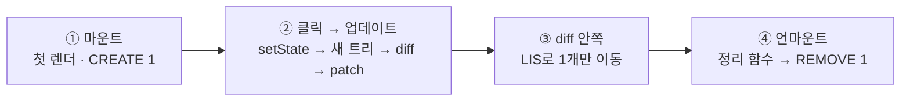
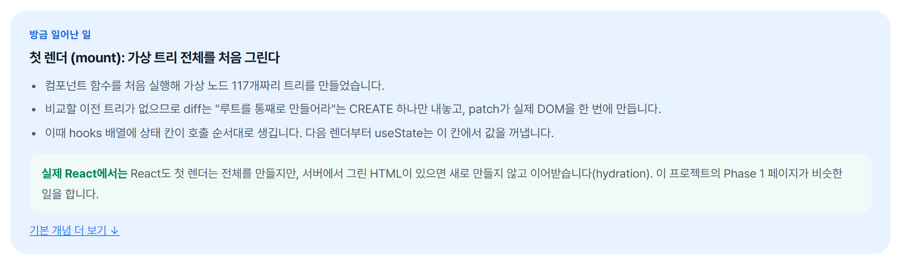
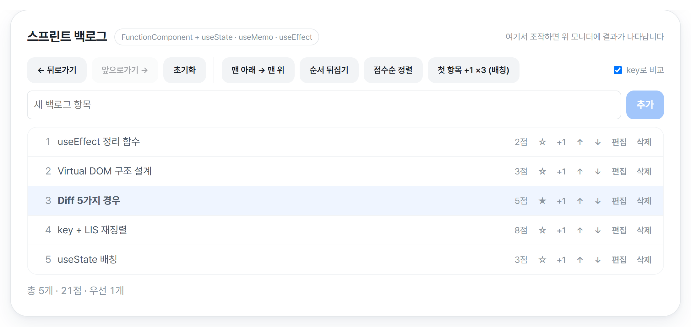
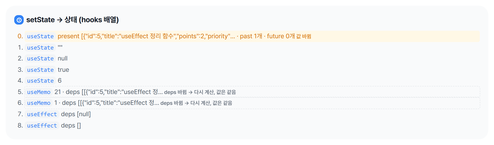
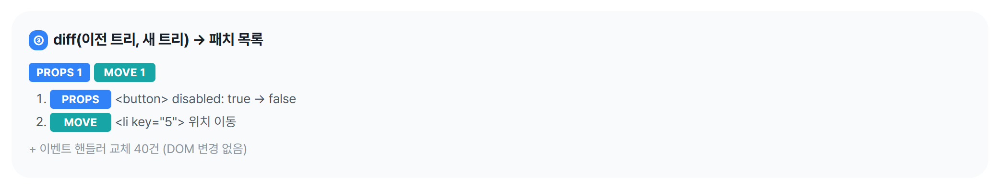
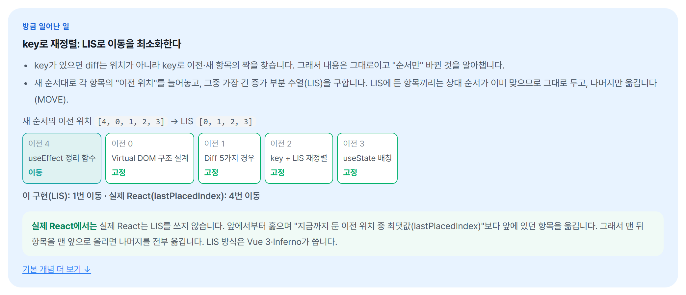
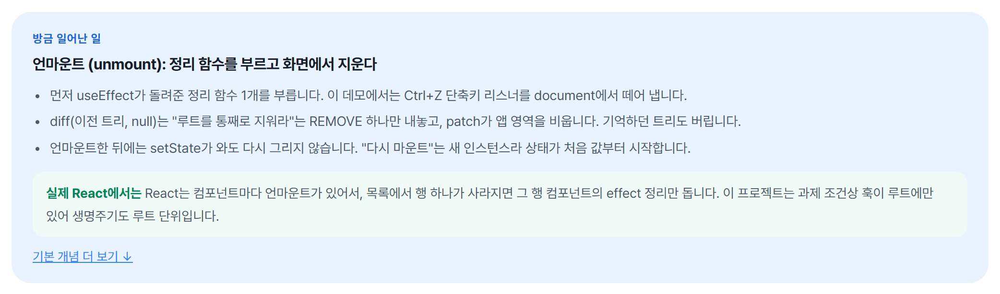

<div align="center">


<br>

**컴포넌트 하나가 마운트되고, 클릭 한 번에 바뀌고, 언마운트되기까지**

<p>
  
  
  
  
</p>

<sub>크래프톤 정글 13기 · 미니 React 구현 과제 · 구현(`src/`)과 데모는 React 없이 Vanilla JS</sub>

[빠른 실행](#-빠른-실행) · [1. 마운트](#1-마운트-실행-전-준비-작업) · [2. 클릭 → 업데이트](#2-클릭--업데이트) · [3. 왜 하나만 옮겼나](#3-왜-하나만-옮겼나-lis) · [4. 언마운트](#4-언마운트-정리하고-끝) · [정확성과 범위](#-정확성과-범위) · [더 보기](#-더-보기)

</div>

<br>

## ⚡ 빠른 실행

```bash
npm ci
npm run serve   # → http://127.0.0.1:5173/demo/integrated/
```

종합 데모 하나로 아래 네 장면을 그대로 따라 할 수 있습니다. **새로 고침 → "맨 아래 → 맨 위" → 모니터의 "언마운트"** 순서입니다.



엔진은 두 부분으로 나뉩니다. **훅(Phase 2)** 이 상태를 기억하고 "화면이 이렇게 생겨야 한다"는 새 가상 트리를 만들고, **diff · patch(Phase 1)** 가 이전 트리와 비교해 실제 DOM의 바뀐 곳만 고칩니다.

<br>

## 1. 마운트: 실행 전 준비 작업

빈 `<div id="app">`에 `mountComponent(App, root)`를 부르면 시작합니다. 모니터의 **렌더 #1** 이 이 장면입니다.



1. **상태 칸 만들기** — 컴포넌트를 처음 실행하면서 `useState` · `useMemo` · `useEffect`가 불린 순서대로 hooks 배열에 칸이 생기고 초기값이 들어갑니다(이 데모는 9칸).
2. **첫 가상 트리** — 컴포넌트가 돌려준 `h(...)` 호출들이 가상 노드 객체가 됩니다(117개). 아직 실제 DOM은 없습니다.
3. **diff → CREATE 하나** — 비교할 이전 트리가 없으니 "통째로 만들어라" 하나만 나옵니다.
4. **patch → DOM 생성 + 리스너** — 실제 요소를 만들어 한 번에 붙이고(DOM 변경 기록 1건), 버튼마다 **리스너를 한 번만** 달아 실행할 함수는 **핸들러 상자**에 넣어 둡니다.
5. **기억하고 effect 실행** — 이 트리를 다음 비교용으로 저장하고, `useEffect`(여기서는 Ctrl+Z 단축키 달기)를 실행합니다.

<br>

## 2. 클릭 → 업데이트

**"맨 아래 → 맨 위"** 를 한 번 누른 장면(렌더 #2)입니다.



| 순서 | 무슨 일이 일어나나 |
|:---:|---|
| 1 | 브라우저가 클릭을 받아 마운트 때 달아 둔 **리스너**를 실행하고, 리스너는 **상자에서 함수를 꺼내** 실행 |
| 2 | 그 함수가 `setState`를 부름 → hooks 0번 칸의 목록이 **바로** 바뀌고, 다시 그리기는 **예약만** (한 클릭에 여러 번 불러도 렌더는 1번) |
| 3 | 클릭 처리가 끝나면 예약된 `update()`가 컴포넌트를 다시 실행 → **새 가상 트리** |
| 4 | **diff** 가 이전 트리와 비교 → 고칠 곳 목록(패치) |
| 5 | **patch** 가 실제 DOM의 그곳만 수정한 뒤, 상자 속 함수를 새것으로 바꿔 다음 클릭 준비 → `useEffect` |

**상태: 바뀐 칸은 하나**

| hooks 칸 | 무엇을 저장하나 | 누르기 전 | 누른 뒤 |
|---|---|---|---|
| 0번 `useState` | 목록과 되돌리기 기록 | 1 · 2 · 3 · 4 · 5 순서, 기록 0개 | **5** · 1 · 2 · 3 · 4 순서, 기록 **1개** |
| 5 · 6번 `useMemo` | 총점 · 우선 항목 수 | 21 · 1 | 21 · 1 (목록이 새 배열이라 다시 계산, 값은 같음) |
| 나머지 6칸 | 입력 글자, 편집 중 항목, 단축키 effect 등 | 그대로 | 그대로 |



> **훅이 상태를 찾는 법** — 함수 컴포넌트는 렌더할 때마다 처음부터 다시 실행되니 지역 변수에 상태를 둘 수 없습니다. 그래서 값은 엔진이 들고 있는 **hooks 배열**에 두고, `useState`는 "이번 렌더에서 몇 번째로 불렸는가"로 자기 칸을 찾습니다. 조건문 안에서 훅을 부르면 안 되는 이유입니다.
> `useState`는 값을 넣는 칸(바꾸면 다시 그리기 예약), `useMemo`는 계산 결과를 아껴 두는 칸(재료가 그대로면 다시 계산 안 함), `useEffect`는 화면을 고친 뒤에 할 일을 적어 두는 칸입니다.

**화면: 새 트리 노드 117개 중 고칠 곳 2개**



- `MOVE` 행 하나를 맨 앞으로, `PROPS` 뒤로가기 버튼 켜기. 나머지 네 행은 **같은 DOM 노드**를 그대로 씁니다.
- 렌더마다 클릭 함수 40개도 새로 만들어지지만 DOM은 건드리지 않고 **상자 속 함수만** 바꿉니다([핸들러 상자](docs/perf/handler-box.md)). 상자가 없던 때는 1,000행 벤치마크에서 같은 데이터를 다시 그려도 패치가 2,000개 나왔습니다(지금은 0).

<br>

## 3. 왜 하나만 옮겼나: LIS



새 순서대로 각 행의 이전 위치를 늘어놓으면 `[4, 0, 1, 2, 3]`. 그중 **가장 긴 증가 부분 수열(LIS)** `[0, 1, 2, 3]`은 이미 순서가 맞으니 두고 나머지만 옮깁니다(Vue 3와 같은 방식). React의 `lastPlacedIndex` 규칙대로면 같은 입력에서 4개를 옮깁니다.

**정말 이득인지 쟀습니다.** 이동 판단만 다른 두 모드(LIS / 단방향 스캔)와 실제 React 18.3.1에 같은 DOM 계수기를 붙였습니다.


| 1,000행에서 | LIS | 단방향 스캔 · 실제 React |
|---|---|---|
| 멀리 떨어진 두 행 교환 | 옮긴 노드 **2** | **997** |
| 1%만 이동 | DOM 조작까지의 JS 시간 **0.59×** | 1× |
| 전부 섞기 | 시간 차이를 검출하지 못함 | |
| 뒤집기 | 옮기는 수가 같음 (이득 0) | |

> **결론** — 일부만 옮기는 흔한 갱신에서 이득이 있고, 다 섞이면 이득이 없습니다. 그래서 LIS를 기본값으로 두었습니다. "React보다 빠르다"는 주장은 하지 않습니다(레이아웃·페인트는 재지 않음). 전체 방법과 한계: [LIS 실험 보고서](docs/perf/lis-experiment.md)

<br>

## 4. 언마운트: 정리하고 끝

모니터의 **언마운트** 버튼을 누르면 됩니다. **다시 마운트**는 새 인스턴스라 처음 상태부터 그립니다.



```js
useEffect(() => {
  doc.addEventListener('keydown', onKeyDown);                  // ① 마운트 때 실행
  return () => doc.removeEventListener('keydown', onKeyDown);  // ④ 언마운트 때 실행 (정리 함수)
}, []);
```

1. **정리 함수 실행** — effect가 돌려준 정리 함수를 모두 부릅니다(단축키 리스너 떼기).
2. **diff(이전 트리, null) → REMOVE 하나** — patch가 앱 영역을 비웁니다.
3. **이후 setState는 무시** — 사라진 컴포넌트는 다시 그리지 않습니다.

<br>

## ✅ 정확성과 범위

- **정확성** — 정답지를 HTML 표준 파서(jsdom `innerHTML`)로 두고, 무작위 HTML을 엔진으로 patch한 결과와 비교하는 fuzz(불일치 0). 이 fuzz와 엣지 케이스 조사로 폼 상태 버그 4개를 찾아 고쳤습니다. 테스트 402개 통과.
- **과제 요구사항** — 조건마다 함수 · 테스트 이름으로 확인: [요구사항 체크리스트](docs/requirements-checklist.md)

| | 실제 React | 이 구현 |
|---|---|---|
| 재정렬 | `lastPlacedIndex` | **LIS** (최소 이동) |
| 이벤트 | 루트 하나에서 받아 최신 props의 핸들러 실행 | 요소마다 리스너 하나 + 핸들러 상자 |
| 생명주기 · 상태 | 컴포넌트마다 | 루트 하나(과제 조건: 훅은 루트만, 자식은 순수 함수) |
| useEffect | 보통 그린 뒤 비동기 | patch 직후 동기 |
| 없는 것 | — | Fiber · Concurrent, Context · Ref · Error Boundary |

<details>
<summary><b>엔진 사용 예제 · Counter</b></summary>
<br>

```js
import { h, mountComponent, useState, useEffect, useMemo } from './src/index.js';

// 자식 컴포넌트: 훅 없이 props만 받는 순수 함수
function Label({ value }) {
  return h('strong', {}, value);
}

// 루트 컴포넌트: 상태와 훅은 여기에만
function Counter() {
  const [count, setCount] = useState(0);
  const doubled = useMemo(() => count * 2, [count]);
  useEffect(() => {
    document.title = `count: ${count}`;
  }, [count]);
  return h('button', { onClick: () => setCount((n) => n + 1) }, '두 배: ', h(Label, { value: doubled }));
}

const app = mountComponent(Counter, document.querySelector('#root'), {}, {
  onCommit: (patches) => console.log(patches.map((p) => p.type)), // 렌더마다 적용한 패치
});
// 처음: ['CREATE'] → 버튼을 누르면 ['TEXT'] (<strong>의 0 → 2만 고친다)
// app.unmount();
```
</details>

<details>
<summary><b>실행 명령 · 폴더 구성</b></summary>
<br>

```bash
npm ci                         # 런타임 의존성 0 (개발용 vitest · jsdom · react 18.3.1은 비교 기준선)
bash .claude/check.sh          # 전체 검사 (CI와 같음)
npm run serve                  # 데모 → http://127.0.0.1:5173/demo/
npm run fuzz -- --seed 3       # 차등 fuzz 긴 실행
npm run bench                  # 대량 목록 벤치마크 (Node + jsdom)
```

- Node `^20.19.0 || >=22.12.0` (CI는 Node 20)
- 데모 캡처(`docs/images/demo-*.png`)는 Chrome에서 폭 1100px · 2배율로, 종합 데모를 새로 연 상태에서 찍었습니다.

```
src/
├─ vdom/   createElement · vnode · domToVNode · serialize · render
├─ diff/   diff(비교) · lis · patch(실제 DOM을 바꾸는 유일한 곳)
└─ hooks/  component(FunctionComponent: mount · update · unmount) · hooks(useState · useEffect · useMemo)
demo/      integrated(종합) · phase1 · phase2 · bench · shared
```
</details>

<br>

## 📚 더 보기

| 문서 | 내용 |
|---|---|
| [이전 README (연구 보고서 형식)](docs/research-readme.md) | Part 1 · Part 2의 자세한 근거, 트레이드오프 표, 공통 기반 개선 |
| [LIS 실험 보고서](docs/perf/lis-experiment.md) | 방법, 결과, 사실과 가설, 한계 · 원자료 CSV |
| [실제 React와의 차이](docs/react-differences.md) | 18개 주제 비교표 |
| [요구사항 체크리스트](docs/requirements-checklist.md) | 과제 조건별 충족 여부와 증거 |
| [ADR 0001](docs/decisions/0001-plan.md) · [ADR 0002](docs/decisions/0002-conditional-items.md) | 계획, 성능 예산, 하지 않기로 한 것과 이유 |
| [최종 보고](docs/final-report.md) | 바꾼 것 · 검사 결과 · 남은 한계 |
