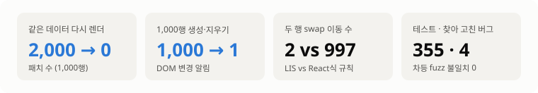
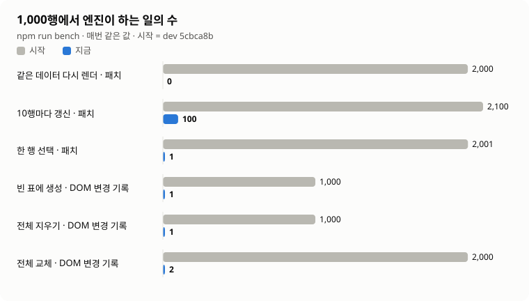
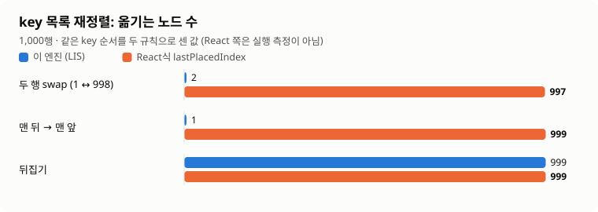
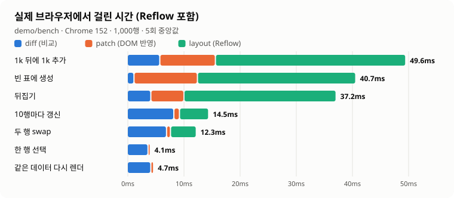
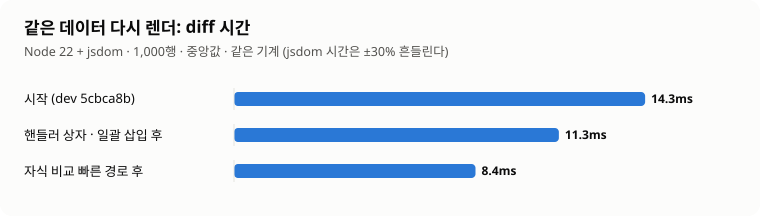
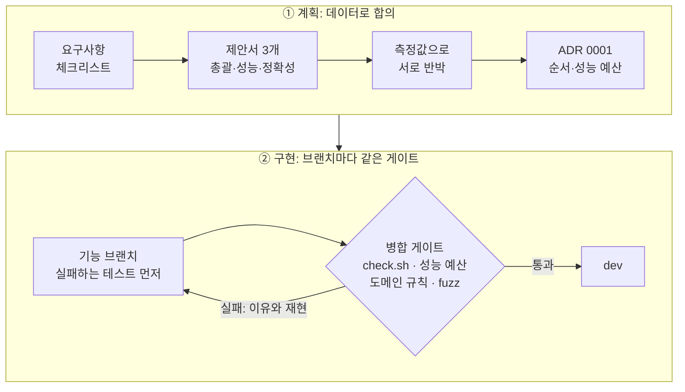
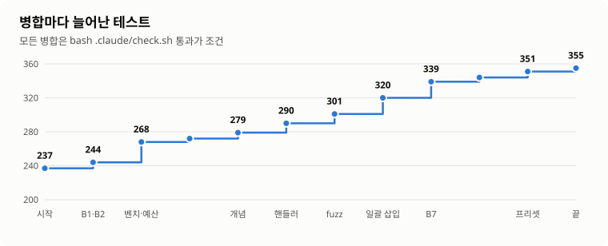
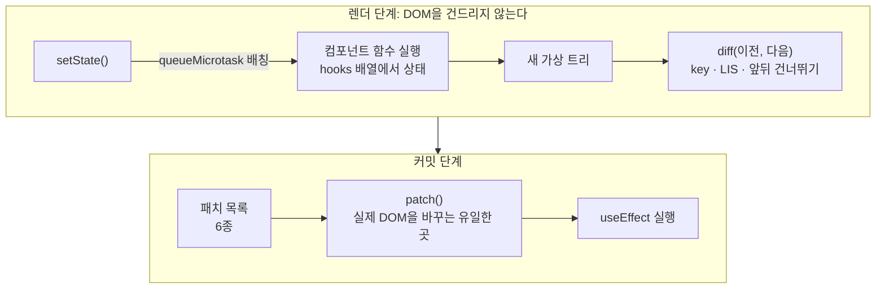
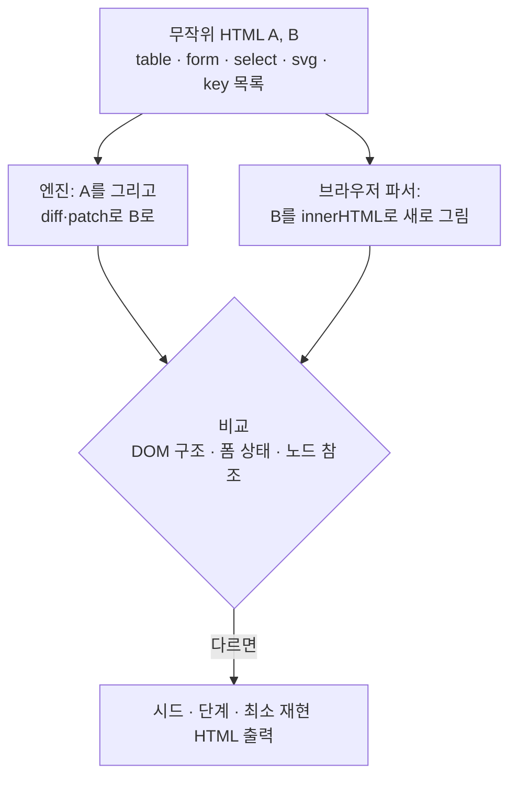

<div align="center">

# mini-react

**하지 않아도 될 일을 하지 않는 미니 React — 그리고 그것이 맞다는 증명**

Virtual DOM · Diff · Patch · Hooks를 라이브러리 없이 직접 구현하고,<br/>
"바뀐 곳만 고친다"를 **숫자로 재고, 브라우저와 대조해 증명**했습니다.


크래프톤 정글 13기 팀 프로젝트

</div>

<picture>
  <source media="(prefers-color-scheme: dark)" srcset="docs/images/highlights-dark.svg">
  
</picture>

---

## 목차

1. [무엇을 만들었나](#1-무엇을-만들었나)
2. [결과: 숫자로 보기](#2-결과-숫자로-보기)
3. [어떻게 진행했나](#3-어떻게-진행했나)
4. [핵심 구현](#4-핵심-구현)
5. [정확성 증명: 브라우저와 대조하는 fuzz](#5-정확성-증명-브라우저와-대조하는-fuzz)
6. [데모](#6-데모)
7. [실제 React와의 차이 · 한계](#7-실제-react와의-차이--한계)
8. [실행 방법](#8-실행-방법)
9. [문서](#9-문서)

---

## 1. 무엇을 만들었나

| | 구현한 것 |
|---|---|
| **Phase 1** Virtual DOM · Diff · Patch | 실제 DOM ↔ 가상 노드 변환, 패치 6종(CREATE · REMOVE · REPLACE · PROPS · TEXT · MOVE), key 목록의 **LIS 기반 최소 이동**, patch 실패 시 이전 화면 복구 |
| **Phase 2** Component · Hooks | `FunctionComponent`(hooks 배열 · `mount()` · `update()`), `useState` · `useEffect` · `useMemo`, 마이크로태스크 배칭, 무한 갱신 방지 |
| **연결** | `setState` → 새 가상 트리 → Phase 1의 `diff` → `patch` 하나의 파이프라인 |
| **고도화** | 대량 목록 최적화 3종, CI 성능 예산, 브라우저 대조 차등 fuzz, 브라우저 벤치마크 페이지, 학습용 데모 4종 |

과제 필수 요구사항은 [요구사항 체크리스트](docs/requirements-checklist.md)에서 조건마다 증거(파일:줄, 테스트 이름)와 함께 모두 ✅입니다.

---

## 2. 결과: 숫자로 보기

> 아래 수치는 모두 저장소 안의 명령으로 다시 낼 수 있습니다: `npm run bench`(Node + jsdom), `/demo/bench/`(실제 브라우저).
> 작업 수(패치·DOM 변경)는 **매번 같은 값**이 나오는 지표라 CI가 상한을 지킵니다. 시간은 참고값입니다.

### 엔진이 하는 일의 수 — 최대 2,000배 줄었다

<picture>
  <source media="(prefers-color-scheme: dark)" srcset="docs/images/work-dark.svg">
  
</picture>

- **패치 = 실제로 해야 할 일.** 렌더마다 새로 만들어지는 이벤트 핸들러가 행마다 PROPS 패치를 만들고 있었습니다(DOM은 그대로인데 패치 2,000개). 핸들러 상자로 이를 없애 이제 패치 수가 실제 DOM 작업 수와 같습니다.
- **DOM에 알리는 횟수 1,000 → 1.** 이어지는 생성은 `DocumentFragment` 한 번, 자식 전체 삭제는 한 번에 비웁니다.

### key 재정렬 — 이론 최소만 옮긴다

<picture>
  <source media="(prefers-color-scheme: dark)" srcset="docs/images/moves-dark.svg">
  
</picture>

React는 앞에서부터 훑으며 "제자리에 둔 마지막 위치(`lastPlacedIndex`)"보다 앞에 있던 노드를 옮깁니다. 이 엔진은 **최장 증가 부분 수열(LIS)** 로 그대로 둘 노드를 고르므로(Vue 3 방식) 옮기는 수가 이론 최솟값입니다.
<sub>React 쪽 수는 같은 key 순서를 그 규칙대로 센 값이며, React를 실행해 잰 값은 아닙니다.</sub>

### 실제 브라우저 시간 — 무엇이 비싼가

<picture>
  <source media="(prefers-color-scheme: dark)" srcset="docs/images/browser-dark.svg">
  
</picture>

- 행을 만드는 작업은 patch보다 **레이아웃(Reflow)이 2~3배** 비쌉니다. DOM을 건드리는 노드 수 자체를 줄여야 하는 이유입니다.
- 바꿀 것이 없는 렌더(선택·같은 데이터)는 **layout 0ms**. DOM을 건드리지 않으면 브라우저도 다시 계산하지 않습니다 — "필요한 곳만 고친다"가 시간으로 보이는 지점입니다.

### diff 자체도 빨라졌다

<picture>
  <source media="(prefers-color-scheme: dark)" srcset="docs/images/diff-dark.svg">
  
</picture>

목록 앞뒤의 같은 key 구간은 바로 짝지어 비교하고 가운데만 key·LIS로 처리합니다. **결과 패치 목록은 이전 코드와 똑같습니다**(무작위·편집 트리 40,000쌍 대조, 불일치 0).

---

## 3. 어떻게 진행했나

필수 요구사항을 채운 뒤, 세 역할(총괄 · 성능 · 정확성/학습)이 **각자 제안서를 내고 서로의 안을 측정값으로 반박**한 다음 계획을 정했습니다. "데이터 없는 주장은 받지 않는다"가 규칙이었습니다.



| 단계 | 한 일 | 결과 |
|:---:|---|---|
| 0 | 요구사항 체크리스트 · 제안서 3개 · [ADR 0001](docs/decisions/0001-plan.md) | 특화 방향과 순서, 성능 예산 확정 |
| 1 | 폼 속성 순서 수정 · 벤치마크 하네스 · CI 성능 예산 | **B1** 다중 select 선택 오류, **B2** type 변경 시 value 잔존 수정 |
| 2 | 주석으로 갈린 텍스트 정규화 · 개념 설명 4절 | **B3** "아무것도 안 고친 Patch"가 DOM을 바꾸던 문제 수정 |
| 3 | 브라우저 파서 대조 차등 fuzz | 긴 실행으로 **B6 · B7** 발견 |
| 4 | 핸들러 상자 | 같은 데이터 다시 렌더 패치 2,000 → **0** |
| 5 | 일괄 삽입 · 선택 그룹 동기화 | DOM 변경 기록 1,000 → **1**, B6 · B7 수정 |
| 6 | 자식 비교 빠른 경로 | diff 11.3 → **8.4ms**, 패치 목록 동일 |
| 7 | Phase 1 프리셋 · 브라우저 벤치마크 페이지 | 레이아웃 시간까지 측정 |
| 8–9 | [실제 React와의 차이](docs/react-differences.md) · [ADR 0002](docs/decisions/0002-conditional-items.md) | 이득이 작은 최적화는 **측정 후 하지 않기로** 결정 |

**병합 게이트** — 모든 브랜치가 통과해야 `dev`에 들어갑니다.
- `bash .claude/check.sh` 통과 (테스트 전부, Stop 훅·CI와 같은 파일)
- **강한 성능 예산**: 시나리오별 패치 수 · DOM 변경 기록 · 붙이고 뗀 노드 · 새 노드 상한. 최적화 브랜치는 같은 커밋에서 상한을 측정값으로 낮춰야 함
- 도메인 규칙: 실제 DOM 변경은 `src/diff/patch.js`에서만, 훅은 루트 컴포넌트에서만, 런타임 의존성 0

<picture>
  <source media="(prefers-color-scheme: dark)" srcset="docs/images/tests-dark.svg">
  
</picture>

---

## 4. 핵심 구현



<details>
<summary><b>LIS로 최소 이동</b> — key 목록 재정렬</summary>

짝이 있는 자식의 "이전 위치"를 새 순서대로 늘어놓으면, 그중 **증가하는 가장 긴 부분 수열**은 이미 상대 순서가 맞으므로 그대로 둡니다. 나머지만 MOVE합니다. 뒤에서부터 처리하므로 "바로 뒤 형제"는 항상 제자리에 있습니다.
`src/diff/diff.js` · `src/diff/lis.js`
</details>

<details>
<summary><b>자식 비교 빠른 경로</b> — 앞뒤 공통 구간 건너뛰기</summary>

대부분의 다시 렌더는 목록의 앞뒤가 그대로입니다. 앞에서부터 같은 key인 자리, 뒤에서부터 같은 key인 자리는 짝과 위치가 정해져 있으므로 이름표·Map·LIS 없이 바로 비교하고, 가운데만 일반 알고리즘을 씁니다. 결과 패치 목록이 이전과 같다는 것을 무작위 트리 40,000쌍으로 확인했습니다.
</details>

<details>
<summary><b>핸들러 상자</b> — 핸들러가 바뀌어도 DOM은 그대로</summary>

요소마다 리스너를 한 번만 달고, 리스너는 "지금 핸들러 표"를 보고 부릅니다. 렌더마다 새 함수가 와도 diff는 패치 대신 표 교체 목록에 담고, patch는 모든 DOM 패치가 성공한 뒤 표만 바꿉니다. React의 이벤트 위임·Vue의 invoker와 같은 목적입니다. → [설계](docs/perf/handler-box.md)
</details>

<details>
<summary><b>일괄 삽입</b> — DOM 변경 알림 1,000 → 1</summary>

같은 부모에 이어지는 CREATE는 `DocumentFragment`에 모아 `insertBefore` 한 번, 한 부모의 자식을 전부 지우는 REMOVE는 `textContent = ''` 한 번. 브라우저 시간 이득은 작았지만(넣기 36.5 → 36.2ms), MutationObserver 알림이 1,000 → 1로 줄고 빈 `<select>`의 선택 버그(B6)가 함께 고쳐졌습니다. → [설계와 측정](docs/perf/batch-insert.md)
</details>

<details>
<summary><b>선택 그룹 동기화</b> — 폼 상태가 브라우저와 같게</summary>

하나만 고르는 select의 option끼리, 같은 name의 radio끼리는 서로의 선택을 바꿉니다. diff는 바뀐 속성만 다시 넣으므로 형제가 풀린 채 남을 수 있었습니다(B7). patch 끝에 선택에 영향을 준 그룹만 속성대로 다시 맞추고, 사용자가 고른 것과 상관없는 변경에는 손대지 않습니다.
</details>

---

## 5. 정확성 증명: 브라우저와 대조하는 fuzz

최적화가 결과를 바꾸지 않았다는 것을 어떻게 믿을까요? **정답지를 브라우저 자신**으로 두었습니다.



찾아서 고친 폼 상태 버그:

| 버그 | 증상 | 찾은 방법 |
|---|---|---|
| **B1** | 다중 select에서 일부 선택이 사라짐 | fuzz 6,000번 중 377번 |
| **B2** | input `type`을 바꿔도 이전 `value`가 속성으로 남음 | 폼 엣지 케이스 조사 |
| **B6** | 빈 select에 option을 넣으면 마지막 것이 선택됨 | fuzz 긴 실행 |
| **B7** | 단일 선택 select · 같은 name radio의 형제 선택이 풀린 채 남음 | fuzz 긴 실행 |

고친 뒤: CI 시드 불일치 **0**, 긴 실행 5개 시드(각 4,000 patch) 불일치 **0**. 실패하면 시드와 최소 재현 HTML이 나오므로 `npm run fuzz -- --seed <시드>`로 그대로 재현됩니다.

---

## 6. 데모

```bash
npm ci
npm run serve   # → http://127.0.0.1:5173/demo/
```

| 페이지 | 무엇을 볼 수 있나 |
|---|---|
| **Phase 1** `demo/phase1/` | 테스트 영역 HTML을 고치고 **Patch** → 바뀐 곳만 실제 영역에 반영(노랗게 깜빡임), **뒤로가기·앞으로가기**. 프리셋 5종(표 · 폼 · 선택 상자 · 중첩 목록 · key 재정렬)을 단계별로 눌러 패치 종류 확인 |
| **Phase 2** `demo/phase2/` | 훅으로 만든 학습 트래커. 렌더마다 패치 목록과 `hooks` 배열을 옆 패널에 표시 |
| **종합** `demo/integrated/` | 앱을 조작하면 ① setState → ② 새 가상 트리 → ③ diff → ④ 실제 DOM 변경을 단계별로. 동작마다 개념 카드(LIS · key · 배칭 · Reflow · MutationObserver …) |
| **벤치마크** `demo/bench/` | 14개 시나리오를 이 브라우저에서 실행: 작업 수와 diff · patch · **layout** 시간 |

---

## 7. 실제 React와의 차이 · 한계

자세한 비교표(18개 주제): [docs/react-differences.md](docs/react-differences.md)

| | |
|---|---|
| **같은 생각** | 렌더(새 트리 + diff, DOM 안 건드림)와 커밋(patch)을 나눔 · key로 목록 비교 · 훅은 호출 순서로 자기 칸을 찾음 |
| **다르게 한 것** | 재정렬은 `lastPlacedIndex` 대신 LIS · 이벤트는 위임 대신 요소별 리스너 + 핸들러 상자 · `useEffect`는 patch 직후 동기 실행 |
| **없는 것** | Fiber · Concurrent 렌더링, 자식 컴포넌트 상태(과제 조건: 훅은 루트만), `memo` · Context · Ref · Error Boundary |
| **주장하지 않는 것** | "React보다 빠르다" — 같은 조건에서 실제 React를 잰 적이 없습니다 |
| **알려진 한계** | 핸들러 상자 · 일괄 삽입의 **시간** 이득은 측정 흔들림 안이거나 작음(이득은 작업 수) · value·selected 없는 단일 선택 select 맨 앞에 option을 넣으면 이전 자동 선택이 남음(React와 같음) · 잘못 중첩된 HTML은 Phase 1 왕복에서 원래대로 돌아오지 않음(HTML 파서 규칙) |

---

## 8. 실행 방법

```bash
npm ci                     # 설치 (런타임 의존성 0, 개발용 vitest · jsdom)
npm test                   # 테스트
bash .claude/check.sh      # 전체 검사 (CI와 같음)
npm run serve              # 데모 → http://127.0.0.1:5173/demo/
npm run bench              # 벤치마크 (1k, 11회 중앙값)
npm run bench -- --rows 10000 --runs 1 --warmup 0
npm run fuzz -- --seed 3   # 차등 fuzz 긴 실행
node scripts/readme-charts.js   # 이 README의 그래프 다시 만들기
```

<details>
<summary>환경 참고</summary>

- Node `^20.19.0 || >=22.12.0` (CI는 Node 20)
- 의존성을 바꿀 때(lock 파일이 바뀌는 설치)는 `npx npm@11 install <패키지>`. npm 10.9.x의 `npm install`은 vitest@4의 선택적 peer 의존성 계산 중 `Cannot read properties of null (reading 'edgesOut')`로 실패합니다. `npm ci`는 npm 10에서도 정상입니다.
- `npm run serve`는 127.0.0.1에서만 열리고 `demo/` · `src/` · `scripts/bench/`만 내보냅니다.
</details>

```
src/
├─ vdom/   createElement · vnode · domToVNode(실제 DOM → 가상 노드) · serialize · render
├─ diff/   diff(비교) · lis(최장 증가 부분 수열) · patch(실제 DOM 반영)
└─ hooks/  component(FunctionComponent) · hooks(useState · useEffect · useMemo)
demo/      phase1 · phase2 · integrated · bench · shared
scripts/   serve.js · bench/ · fuzz.js · readme-charts.js
docs/      체크리스트 · 제안서 · ADR · 벤치마크 · React 비교 · 최종 보고 · images(README 그래프)
```

---

## 9. 문서

| 문서 | 내용 |
|---|---|
| [요구사항 체크리스트](docs/requirements-checklist.md) | 과제 조건별 충족 여부와 증거 |
| [ADR 0001 고도화 계획](docs/decisions/0001-plan.md) | 특화 방향, 개선 목록, 성능 예산, 버린 안과 이유 |
| [ADR 0002 조건부 항목](docs/decisions/0002-conditional-items.md) | 측정해 보고 하지 않기로 한 최적화 |
| [벤치마크](docs/benchmarks.md) | 지표 정의, 기준선, 개선 기록, 브라우저 결과 |
| [핸들러 상자](docs/perf/handler-box.md) · [일괄 삽입](docs/perf/batch-insert.md) | 설계와 측정 |
| [실제 React와의 차이](docs/react-differences.md) | 18개 주제 비교, 주장할 수 있는 것과 없는 것 |
| [최종 보고](docs/final-report.md) | 바꾼 것 · 검사 결과 · 남은 한계 |
| [제안서](docs/proposals/mr-lead.md) | 총괄 제안서 |
