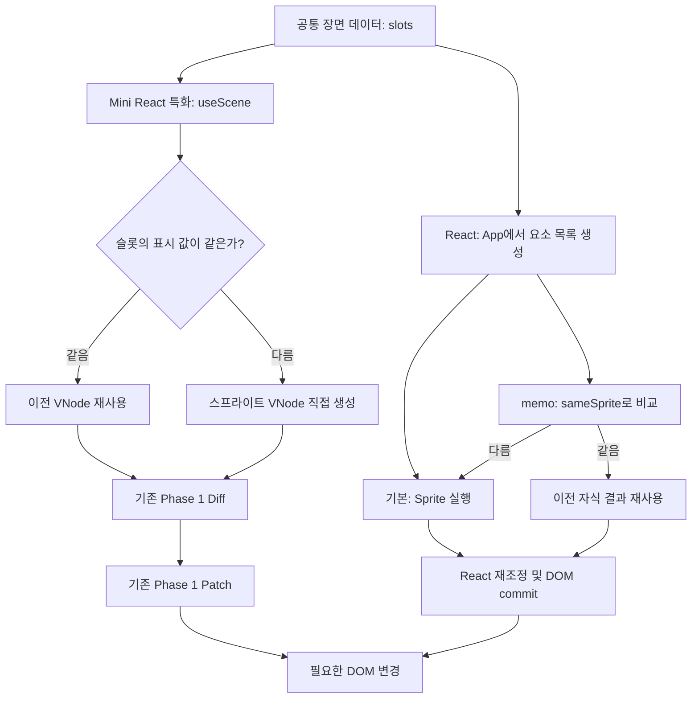
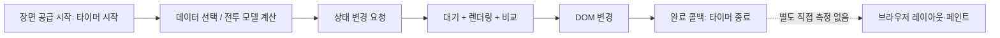

# React와 특화 Mini React: 현재 렌더링 실험 해설

2026-11-10 · 현재 소스 기준 · 구조 설명 자료

**핵심: 두 렌더러 모두 필요한 DOM만 변경한다. 차이는 그 변경을 알아내기까지 수행하는 계산이다. 특화 Mini React는 화면을 ‘고정 슬롯의 평면 스프라이트’로 제한해 일반 컴포넌트 해석·변환 비용을 줄인다.**

이 자료의 흐름도는 원리를 설명한다. 실제 성능 순위나 배속을 나타내지 않는다.

## 1. 무엇을 비교하는가?

| 실험실 이름 | 화면을 계산하는 경로 | 변경 없는 스프라이트 |
| --- | --- | --- |
| Mini React 일반 | `h(Sprite)` → Sprite 실행 → 일반 `resolve()` → VNode → Diff·Patch | 다시 생성·비교하지만 DOM은 변경하지 않음 |
| Mini React 특화 | `useScene()` → 표시 값 비교 → VNode 직접 생성/재사용 → 기존 Diff·Patch | VNode 재사용. 전체가 같으면 장면 VNode도 재사용 |
| React 기본 | App 실행 → Sprite 요소 목록 → Sprite 실행 → React 재조정 → DOM commit | 컴포넌트를 다시 계산해도 불필요한 DOM 변경은 생략 |
| React memo | App 실행 → MemoSprite 요소 목록 → `sameSprite()` 비교 → 필요할 때 Sprite 실행 → DOM commit | 표시 값이 같으면 Sprite 실행을 건너뛸 수 있음 |

네 방식 모두 같은 장면 데이터, 같은 고정 슬롯 정책, 같은 DOM 구조를 사용한다. React 쪽도 `key: index`로 슬롯을 유지한다. React Compiler와 `flushSync`는 사용하지 않는다.

실험실 기본 선택은 **Mini React 특화 vs React 기본**이다. 메모이제이션을 적용한 상대와 비교하려면 **React memo**를 선택해야 한다.

## 2. 같은 화면을 만드는 서로 다른 경로



일반 컴포넌트는 “이 함수가 어떤 태그와 자식을 반환하는가?”를 실행해서 알아내야 한다. 특화 경로는 “각 슬롯은 자식과 이벤트가 없는 `<i>` 하나”라는 답을 이미 알고 있다. 그래서 그 중간 단계를 줄인다.

비유하면 React는 여러 메뉴를 처리하는 주방, `useScene`은 정해진 메뉴를 만드는 전용 조리대다. 조리대를 단순하게 만들 수 있지만 다른 메뉴를 처리할 유연성은 제한된다.

## 3. 특화 Mini React의 핵심 원리

### A. 스프라이트별 컴포넌트 실행과 일반 변환 생략

일반 Mini React는 `h(Sprite, { slot })`을 만든 뒤 `resolve()`에서 Sprite를 호출하고, 반환된 표현을 VNode로 변환한다. 속성·이벤트·자식 처리도 일반 규칙을 따른다.

특화 Mini React는 `useScene()` 안에서 `spriteNode(slot)`으로 VNode를 직접 만든다. `resolve()`는 특별한 `SCENE` 표시를 만나면 준비된 장면 VNode를 그대로 사용한다. 루트 App과 바깥 컨테이너의 처리는 여전히 수행한다.

**장점:** 수많은 단순 스프라이트에 반복 적용되는 함수 호출, 중간 객체 생성, 일반적인 해석 비용을 줄일 수 있다.

**한계:** 스프라이트 내부에 버튼·입력·중첩 자식·이벤트를 넣는 범용 컴포넌트 기능은 제공하지 않는다. 메뉴와 폼은 일반 `h()` 경로를 사용한다.

### B. 변경 없는 VNode를 같은 객체로 재사용

`sameSprite()`는 `entityId`, `kind`, `x`, `y`, `active`, `hit`를 비교한다. 같으면 이전 VNode를 사용하고, 모두 같으면 장면을 감싸는 VNode까지 재사용한다.

기존 Diff에는 다음 조기 종료가 있다.

```ts
if (before === after) return;
```

같은 불변 객체라면 안쪽 속성·자식을 다시 비교할 필요가 없다는 뜻이다.

**중요한 한계:** 변경 여부를 알아내기 위해 `useScene()`은 여전히 모든 슬롯을 순회하고, 캐시용 표시 데이터를 복사한다. 정지 장면도 루트의 업데이트 전체가 O(1)이 되는 것은 아니다. 모든 객체가 움직이면 새 VNode 생성과 위치 Patch도 계속 필요하다.

또한 좌표 비교는 원래 숫자로 하고 출력은 소수점 둘째 자리로 반올림한다. 아주 작은 좌표 변화는 VNode를 새로 만들더라도 결과 문자열이 같아 DOM 변경은 없을 수 있다.

### C. 프레임 안의 상태 업데이트 묶기

`useFrame()`은 루트당 하나의 `requestAnimationFrame` 예약으로 활성 콜백을 실행하고, 그 동기 구간의 여러 setter를 한 번의 렌더링으로 묶는다.

```text
일반 Mini React의 rAF: set → 렌더 / set → 렌더 / set → 렌더
useFrame 내부:          set → set → set → 한 번 렌더
```

함수형 updater는 호출 순서대로 적용한다. 일반 이벤트의 setter는 기존 동기 동작을 유지한다. `await` 이후와 다른 타이머의 업데이트는 이 배칭에 포함되지 않는다.

**현재 정식 벤치마크에서는 네 렌더러가 프레임당 한 번만 상태를 전달한다. 따라서 ‘배칭 때문에 세 배 빨라졌다’고 해석할 수 없다.** React 자체에도 배칭이 있다.

### D. 고정 슬롯으로 DOM 재사용

```text
슬롯 번호    0       1       2
이전       적 A     적 B     적 C
사망 뒤    적 A     숨김     적 C
재사용     적 A     적 D     적 C
DOM 객체   유지     유지     유지
```

배열을 압축하지 않고 비활성 슬롯을 유지한다. 새 엔티티는 그 자리를 재사용한다.

**장점:** 인덱스가 밀리지 않고 DOM 생성·삭제를 줄일 수 있다.

**단점:** 비어 있는 슬롯의 DOM과 캐시도 메모리에 남는다. 슬롯은 엔티티 자체의 정체성과 다르므로 독립적인 입력·포커스·자식 상태가 있는 일반 목록에 그대로 적용하기 어렵다.

**이 정책은 현재 네 렌더러 모두 공유한다. 특화 Mini React만의 우위가 아니다.** 테스트의 ‘첫 항목 삭제 1,000 작업 vs 첫 슬롯 숨김 1 작업’도 현재 인덱스 Diff에 관한 사례이며 React의 keyed 목록과 비교한 결과가 아니다.

## 4. React memo와는 무엇이 다른가?

React memo도 같은 `sameSprite()`를 사용한다. 입력 객체의 참조만 비교하는 것이 아니라 필드의 실제 값을 비교하므로, 새 객체가 들어와도 표시 값이 같으면 생략할 수 있다.

두 방식의 목표는 비슷하지만 생략하는 위치가 다르다.

- **React memo:** App은 계속 슬롯을 순회해 React 요소를 만들고, React는 memo 경계에서 자식의 실행을 생략할지 판단한다. 범용 컴포넌트 구조를 유지한다.
- **Mini React 특화:** 슬롯을 순회하면서 곧바로 VNode를 만들거나 재사용한다. 스프라이트별 범용 컴포넌트 경로를 통과하지 않는다.

React는 다양한 컴포넌트 트리와 자식 상태 등을 지원한다. 특화 Mini React는 루트만 상태·Hook을 소유하며, 전용 장면의 모양을 제한한다. 특화 구현이 이 실험에서 유리하더라도 범용 UI 전체에서 우월하다는 결론은 아니다.

현재 어댑터의 세부 구현 비용도 다르다. Mini는 `style` 속성 문자열을 Patch하고, React는 style 객체를 전달한다. React Sprite는 `spriteAttributes()`에서 만든 style 문자열을 사용하지 않고 transform 문자열을 다시 만든다. 따라서 측정 차이를 전부 React 내부 구조 하나의 비용이라고 단정할 수도 없다.

## 5. 네 가지 장면의 해석

| 시나리오 | 실제 부하 | 무엇을 살펴볼까? |
| --- | --- | --- |
| 정지 장면 | 매번 새 snapshot으로 업데이트하지만 슬롯 값은 동일 | DOM 수정이 없어도 발생하는 계산·비교 비용. mini-scene과 React memo의 생략 효과 |
| 전체 이동 | 모든 슬롯의 좌표 변경 | 캐시 적중이 거의 없는 경우의 변환·비교·DOM 반영 비용 |
| 생성·사망 | 고정 슬롯의 위치 이동 + 주기적인 active·ID 변경 | 슬롯 내용 교체 비용. 실제 DOM 삽입·삭제 폭증 테스트가 아님 |
| 게임 전체 | 전투 모델 실행 후 장면 렌더링 | 충돌 등 모델 계산까지 포함한 종합 부하 |

정지·이동·생성/사망 장면은 사전 생성 데이터를 재생한다. 생성/사망에서는 숨긴 슬롯도 좌표가 계속 달라지므로, 숨겼다고 그 슬롯의 업데이트가 없어지는 것은 아니다.

게임 전체는 전체 게임 UI 테스트가 아니다. 경기장 장면을 대상으로 프레임을 받아들일 때마다 한 단계씩 모델을 진행한다. 레벨업은 자동 선택하고 사망·승리 시 다시 시작한다. 실제 플레이의 경과 시간 따라잡기, 메뉴 조작, 입력 지연을 평가하는 실험과는 구분해야 한다.

## 6. 숫자는 정확히 무엇을 재는가?



| 지표 | 정확한 의미 | 해석의 한계 |
| --- | --- | --- |
| DOM 반영 p95 | `source()` 시작부터 완료 콜백까지 걸린 시간의 95백분위수 | 순수 DOM 수정 시간만이 아니다. 대기, 렌더링, 모델 계산도 포함하며 픽셀 표시 완료 시간은 아님 |
| 프레임 간격 p95 | 받아들인 장면 공급 rAF 타임스탬프 사이 간격의 95백분위수 | 실제 페인트 프레임을 직접 측정한 값은 아님 |
| 처리 FPS | 받아들인 업데이트들의 타임스탬프 간격으로 계산한 초당 처리율 | 실제 표시 FPS와 동일하다고 보장할 수 없고 화면 주사율의 영향을 받음 |
| 예산 초과율 | 간격이 `1000 / 60 + 1ms`, 약 17.67ms를 넘긴 비율 | 60Hz 기준 지표이며 모든 모니터 주사율에 맞춘 지표는 아님 |
| 별도 진단 | Mini의 render/diff/patch 시간 및 Patch 작업 수 | React 내부와 같은 단위의 비교 지표가 아니며, Patch 작업 수는 DOM API 호출 수와 다름 |

React는 `useLayoutEffect`에서 완료를 알린다. Mini는 이 프로젝트에서 commit 직후 동기 실행되는 `useEffect`에서 알린다. 둘 다 DOM 반영 뒤를 관찰하지만 실제 React의 일반 `useEffect`와 Mini의 `useEffect`가 같은 실행 정책인 것은 아니다.

이전 업데이트가 완료되지 않았다면 다음 장면 공급 요청은 건너뛴다(`waiting`). 무제한으로 업데이트를 쌓는 부하는 아니다. 모든 중간 상태를 처리하는 지속 수신 시스템이나 입력 응답성까지 이 결과로 설명할 수 없다.

## 7. 결과를 어떻게 비교하면 좋을까?

1. **Mini 일반 vs Mini 특화:** 같은 코어에서 전용 장면 경로가 줄이는 비용을 확인한다.
2. **React 기본 vs React memo:** memo 적용의 효과와 비교 비용을 확인한다.
3. **Mini 특화 vs React memo:** 양쪽 모두 변경 없는 표시를 생략하는 조건을 비교한다.

프로덕션 빌드에서 같은 몹 수·시나리오·시드·측정 시간을 사용한다. A→B와 B→A 순서로 반복하면 순서와 기기 상태의 영향을 확인하는 데 도움이 된다. 실제 수치를 얻기 전에는 어느 쪽이 몇 배 빠르다고 쓰지 않는다.

FPS가 둘 다 약 60이어도 DOM 반영 p95가 낮으면 이 부하에서 처리 여유가 더 클 수 있다. 반대로 DOM 반영이 빨라도 실제 체감 부드러움과 입력 응답성은 별도로 확인해야 한다.

종료 후 최종 DOM의 class·엔티티 ID·위치·표시 상태를 확인한다. 전투 모델은 각 실행이 처리한 단계 수만큼 다시 계산해 체크섬을 검증한다. 이는 최종 결과 검증이며 모든 중간 프레임의 시각적 정확성을 검사하는 것은 아니다.

## 8. 구현 위치와 검증

- `src/game/react-adapter.ts`: 실제 React 기본/memo 경로, index key, 완료 콜백.
- `src/game/mini-adapter.ts`: 일반 `h(Sprite)`와 특화 `useScene()`의 차이.
- `src/core/component.ts`: useFrame 배칭, useScene 캐시, 동기 commit 정책.
- `src/core/element.ts`: 일반 표현 변환과 SCENE 우회 경로.
- `src/core/diff.ts`, `src/core/patch.ts`: 동일 참조 생략과 변경 DOM 반영.
- `src/game/benchmark.ts`: 공통 데이터, 타이머, 요청 제한, 정확성 검사.
- `src/game/experiment-ui.ts`: 기본 비교 상대, 지표 표시, JSON/CSV 저장.

이번 자료 작성 시 검증 결과는 아래에 기록한다. 기능 테스트는 성능 순위를 증명하지 않는다.

- `npm test -- tests/game-core.test.ts tests/benchmark.test.ts tests/game-model.test.ts`: **19개 통과**.
- `PLAYWRIGHT_CHANNEL=chrome npm run test:e2e -- tests/browser/game.spec.ts -g 'experiment'`: **2개 통과**. 네 렌더러의 최종 DOM·모델 체크섬, 비교 설정과 결과 UI 확인. 최초 실행은 sandbox의 로컬 포트 제한으로 실패했으며 권한을 확보한 재실행에서 통과.
- 대화 내 비교 시각화: 세 장면 전환, 네 렌더러 표시, 콘텐츠 폭 736px/320px 및 밝은/어두운 테마에서 브라우저 검증. 가로 넘침과 JavaScript 오류 없음.
- 새 성능 순위 측정은 수행하지 않음. 렌더러 구현 변경 없음.

공식 설명: [React의 렌더링과 commit](https://react.dev/learn/render-and-commit), [React memo](https://react.dev/reference/react/memo), [상태 업데이트 배칭](https://react.dev/learn/queueing-a-series-of-state-updates).
